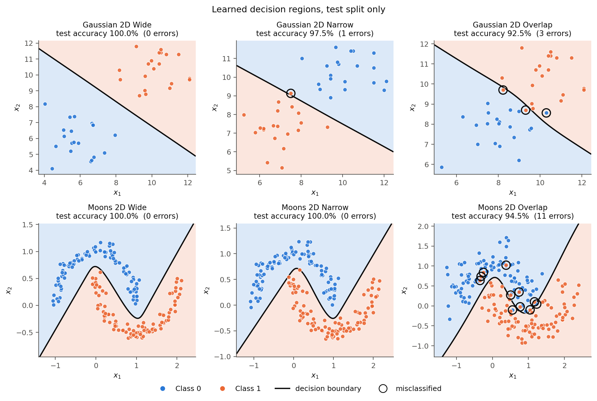
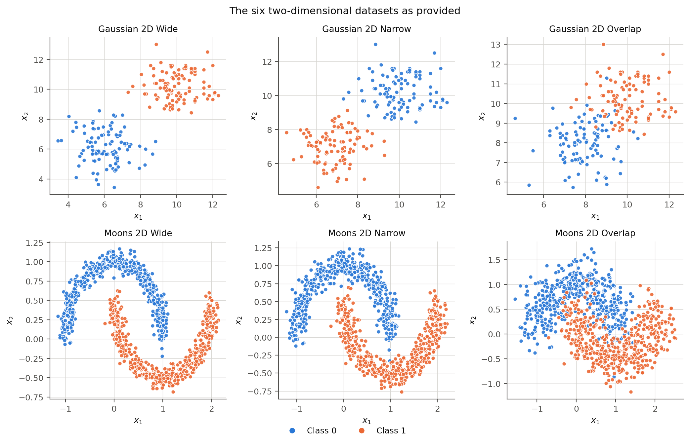
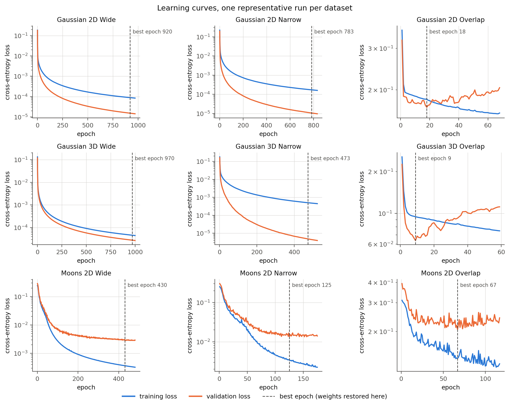
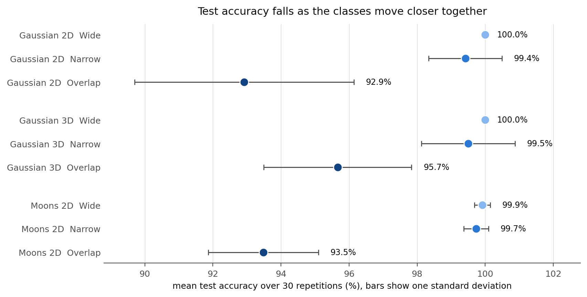
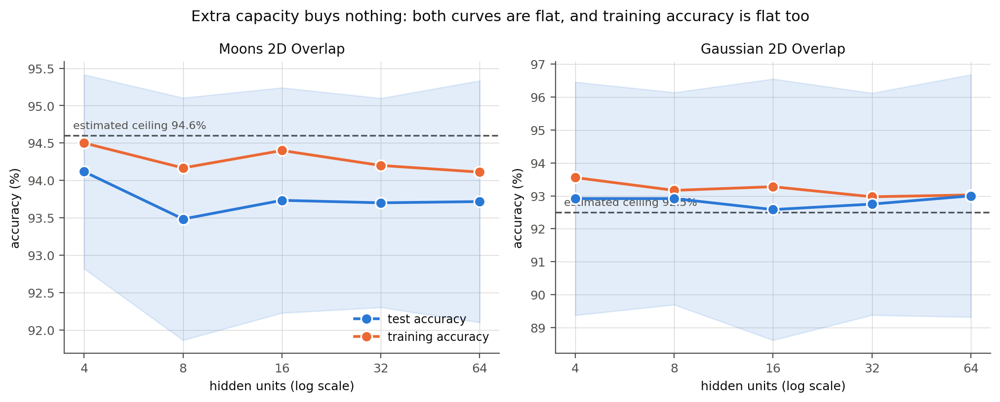

# Feedforward Neural Network with Backpropagation, from Scratch (NumPy)

A two-class neural network classifier and its full backpropagation training loop, written from first principles in NumPy with no machine learning library. Built for CS 4033/5033 Machine Learning Fundamentals at the University of Oklahoma (Fall 2026).



## Highlights

* Forward pass, backpropagation, mini-batch SGD with momentum and early stopping, all hand-written
* Numerical gradient checker to verify the analytic gradients
* Architecture grid search, then **270 evaluation runs** (9 datasets x 30 random seeds)
* Reaches the estimated **Bayes-optimal accuracy ceiling on 8 of 9 datasets**
* Capacity sweep (4 to 64 hidden units) showing the remaining gap is not a capacity limit

## Datasets

Nine synthetic two-class problems: Gaussian clusters in 2D and 3D plus interleaved crescent moons in 2D, each at three separations (Wide, Narrow, Overlap).

## Results (test accuracy, mean over 30 seeds)

| Dataset | Wide | Narrow | Overlap |
|---|---|---|---|
| Gaussian 2D | 100.0% | 99.4% | 92.9% |
| Gaussian 3D | 100.0% | 99.5% | 95.7% |
| Moons 2D | 99.9% | 99.7% | 93.5% |

Accuracy tracks class separation rather than dimensionality: Gaussian 3D Overlap outscores Gaussian 2D Overlap because the third coordinate carries signal, not noise.

| | |
|---|---|
|  |  |
|  |  |

## Repository layout

```
src/        network, data handling, experiments, analysis, plotting
data/       the nine datasets (CSV)
results/    per-run and summary results, grid search, capacity sweep
figures/    all figures
report/     full technical write-up (PDF + LaTeX source)
```

| File | Purpose |
|---|---|
| `src/ann.py` | Network: forward pass, backpropagation, SGD with momentum, early stopping, gradient check |
| `src/data.py` | CSV loading, stratified splitting, standardisation, metrics |
| `src/experiment.py` | Architecture grid search and the 270 evaluation runs |
| `src/analysis.py` | Dataset characteristics and Bayes-ceiling estimates |
| `src/capacity.py` | Hidden-layer capacity sweep |
| `src/plots.py` | Every figure |

## Reproducing

```bash
pip install numpy matplotlib
cd src
python experiment.py   # grid search + 270 runs, about 4 minutes
python analysis.py
python capacity.py
python plots.py
```

The full write-up is in [`report/project1.pdf`](report/project1.pdf).

## Author

Muhammad Ridwanul Hoque, Graduate Student, University of Oklahoma

Course project for CS 4033/5033 (Fall 2026). See the report's final section for details.
